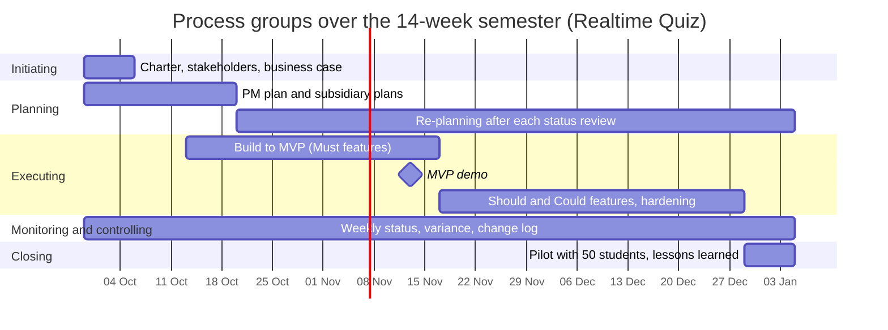

# Lab-01: Project charter for the Realtime Quiz project
**IT Project Management · Chapter 01**

> **PMBOK Guide 7th ed. · Process Groups Practice Guide 2022**  
> **Tools:** Markdown · Spreadsheet · draw.io · Git  
> **Duration:** ≈ 5 hours  
> **Content:** 5 tasks + 1 challenge  

You write the first project management documents of the Realtime Quiz project; each later lab adds its own. You classify initiatives as projects, operations or programmes, write the Realtime Quiz project charter, identify the sponsor, the project manager and the first stakeholders, justify the investment with a business case, and map the five process groups onto the 14-week semester. The challenge analyses a famous IT project failure with the chapter's concepts and turns it into commitments for your own project.

> [!NOTE]  
> **How to work through this lab:** Do the tasks in order; each builds on the previous. Read the *Goal*, follow the *Steps*, compare with the *Expected output*, and tick the *Acceptance checklist*. Open a hint only when stuck for more than 10 minutes. Every deliverable is a text file in your Git repository; commit after each task.

---

## Table of Contents
- [0 · Setup](#0--setup)
- [1 · Project, operation or programme?](#1--project-operation-or-programme-classify-ten-initiatives)
- [2 · Project charter](#2--write-the-realtime-quiz-project-charter)
- [3 · Sponsor, PM and stakeholders](#3--identify-the-sponsor-the-project-manager-and-the-first-stakeholders)
- [4 · Business case](#4--write-the-business-case-do-nothing-buy-a-saas-or-build)
- [5 · Process groups and lab record](#5--map-the-process-groups-to-the-semester-and-record-the-lab)
- [★ Challenge · Failure post-mortem](#-challenge-post-mortem-of-an-it-project-failure)
- [Grading rubric](#grading-rubric)
- [Submission](#submission)

---

## 0 · Setup
*Time: 20 min*

### Tools to install (all free)
1. **Git** and a GitHub (or GitLab) account. Verify:
   ```bash
   git --version        # 2.4x or newer
   git config --global user.name  "Your Name"
   git config --global user.email "you@example.edu"
   ```
2. A **Markdown editor** with preview and Mermaid support: Visual Studio Code with the extensions *Markdown All in One* and *Markdown Preview Mermaid Support*. Any editor works if you can preview tables and Mermaid.
3. A **spreadsheet**: LibreOffice Calc 24.x or Excel 365 (Task 4). Save as `.csv` for Git and keep the `.ods`/`.xlsx` next to it if you use formulas.
4. **draw.io desktop** (diagrams.net 24.x) for the optional organisation sketch in Task 3. **ProjectLibre 1.9** is not needed until Lab-05; install it now if you want to be ahead.

### Case-study recap: the facts every lab uses
There are no earlier labs to reuse. Your inputs are the chapter slides and the case-study brief below; every later lab reuses the files you write here.

#### Case-study brief: the Realtime Quiz platform
- **Purpose:** A web platform on which instructors author multiple-choice quizzes and host live sessions. Students join with a 6-character code and answer each question against a timer; feedback, scores and a leaderboard update instantly over WebSocket.
- **Roles:** Instructor (creates quizzes, runs sessions, sees analytics, exports results); student (joins, answers, sees own score and the leaderboard); guest (registers, or joins with a code and a nickname if the instructor allows it); admin (manages users and roles; a stretch goal).
- **Must features (MVP):** Create quizzes with multiple-choice questions; real-time participation; instant feedback and scoring; leaderboards; real-time updates over WebSocket; authentication and roles; timer per question; multiple concurrent sessions.
- **Should features:** Responsive design; analytics and reporting; export of results to CSV and PDF; real-time notifications; multimedia in questions.
- **Could features:** Chat during sessions; anonymous joining with a nickname; a question bank shared between quizzes; an admin screen for user management.
- **Non-goals:** Native mobile apps; question types other than multiple choice (no free text); video conferencing; LMS integration; multi-node scaling (one server instance).
- **Quality targets:** A broadcast reaches all clients within 500 ms; one instance serves 20 sessions of 100 participants on 2 vCPU and 2 GB RAM; the server's timer is authoritative (client drift under 200 ms); WCAG AA contrast and keyboard access; last two versions of the major browsers; no secrets in the repository; line coverage 80 % or more with CI green on every merge.
- **Build phases:** Ten phases: setup; accounts and security; quiz authoring; live session core; scoring and leaderboard (MVP checkpoint); analytics and export; notifications, media, polish; chat and stretch; testing and hardening with a load test of 100 simulated students; documentation and demo. Each phase ends with a tagged commit and a short demo.
- **Technology and deployment:** Spring Boot (Java), PostgreSQL, WebSocket with STOMP; Docker Compose behind a Caddy reverse proxy that terminates TLS and forwards WebSocket upgrades; configuration through environment variables; hosted on a Linode VPS at gicitc.com.
- **Known risks:** The campus proxy may block WebSocket (fallback: SockJS); Spring Boot 4 and Spring Security 7 are newer than most tutorials; late answers may race with the closing of a question; client clocks drift from the server; the PDF export must render Khmer names; Could features may creep into the MVP.
- **Team and constraints:** 4 students (backend, real-time, frontend, QA/DevOps) with the lecturer as project manager; 14 weeks from 2026-09-29; MVP demo in week 7; pilot with 50 students in week 14; hosting about 25 USD per month within a 200 USD cash cap.

| Input | Value to use | Source |
|---|---|---|
| Product | Realtime Quiz platform: instructors author quizzes and drive live, timed sessions; students join by code, answer, see scores and a leaderboard | Case-study brief, purpose |
| Sponsor | Head of the IT department | Course brief |
| Project manager | Supervising lecturer | Course brief |
| Team | 4 students (backend, real-time, frontend, QA/DevOps) | Course brief |
| Duration | 14 weeks, week 1 starts 2026-09-29 | Course brief, case-study brief |
| Effort | Students 4 x 8 h/week each, PM 3 h/week (490 h total) | Chapter 01, slide 20 |
| Cash | Linode VPS at gicitc.com about 25 USD/month, a domain, optional paid tools; about 200 USD cap | Course brief |
| Go-live | Pilot with 50 students in week 14; MVP (all Must features) demo in week 7 | Course brief, case-study brief |
| Non-goals | Native apps, other question types, video conferencing, LMS integration, multi-node scaling | Case-study brief, non-goals |

### Repository and folder layout
1. Create a repository `pm-plan-<yourname>` with a `README.md` (your name, course, one line per lab as you complete it). Clone it and create the branch `lab-01`.
2. Create the folder `lab01/`. The files you will produce in this lab:
   ```plaintext
   pm-plan-<yourname>/
   ├── README.md
   └── lab01/
       ├── task1-classification.md       (Task 1)
       ├── project-charter.md            (Task 2)
       ├── stakeholders.csv              (Task 3)
       ├── stakeholders.md               (Task 3)
       ├── business-case.md              (Task 4)
       ├── business-case.csv             (Task 4)
       ├── process-groups.md             (Task 5)
       ├── README.md                     (Task 5: lab record)
       └── post-mortem.md                (Challenge)
   ```
3. Commit the empty folder with a `.gitkeep` or the README change: `git add -A && git commit -m "Lab-01: setup"`.

---

## 1 · Project, operation or programme? Classify ten initiatives
*Difficulty: Easy · Time: 30 min*

### Goal
Apply the definitions from the chapter (temporary, unique result, coordinated benefits) to ten initiatives of the IT department and justify each classification in one sentence, so that you can recognise what the rest of the course applies to.

### Steps
1. Create `lab01/task1-classification.md` from the starter below. Keep the ten initiatives exactly as given; do not rewrite them.
2. For each initiative answer the three test questions in the columns *Temporary?* (has a definite end: yes/no), *Unique?* (the result did not exist before: yes/no), *Coordinated?* (several related projects whose benefit exists only together: yes/no).
3. Fill the *Class* column with exactly one of `Project`, `Operation`, `Programme`. Two yeses on temporary and unique make a project; a no on either makes an operation; a yes on coordinated makes a programme.
4. Write one sentence of *Justification* per row that names the deciding fact (the deadline, the repetition, the shared benefit). "Because it is a project" is not a justification.
5. Below the table add a section `## Grey zones` with two initiatives from the list that could be argued either way, and state which extra information (who authorised it, what "done" means, is there a budget) would settle it.
6. Add a section `## What our project hands over`: three sentences on which operations the Realtime Quiz project hands over to at go-live in week 14 (who runs it, what they need from the team).
7. Commit: `git commit -am "Lab-01 Task 1: classification"`.

### Starter: `lab01/task1-classification.md`
```markdown
# Task 1: project, operation or programme?

| #  | Initiative | Temporary? | Unique? | Coordinated? | Class | Justification |
|----|------------|------------|---------|--------------|-------|---------------|
| 1  | Build the Realtime Quiz platform and pilot it with 50 students in week 14 | | | | | |
| 2  | Run the nightly backup of the gicitc.com PostgreSQL database | | | | | |
| 3  | Move the department's three web servers to a new Linode region before 15 December | | | | | |
| 4  | Answer helpdesk tickets within the 4-hour service level | | | | | |
| 5  | "Digital classroom": Realtime Quiz, LMS upgrade and lecture capture sharing one login and one grade export | | | | | |
| 6  | Apply the monthly security patches to the VPS | | | | | |
| 7  | Add multi-node scaling (RabbitMQ relay, Redis registry) to Realtime Quiz next semester | | | | | |
| 8  | Operate the Realtime Quiz platform after go-live: password resets, restarts, monitoring | | | | | |
| 9  | Write and publish the department's annual IT report for the dean by 31 January | | | | | |
| 10 | Replace 40 wireless access points in two buildings during the summer break | | | | | |

## Grey zones
TODO: two rows that could go either way and what would settle them.

## What our project hands over
TODO: three sentences.
```

### Expected output (two rows of a good answer)
```plaintext
| 2 | Run the nightly backup ... | no | no | no | Operation |
    Repeats every night with the same output and no end date;
    it is part of keeping the service running.

| 5 | "Digital classroom": ... | yes | yes | yes | Programme |
    Three related projects; the shared login and grade export are a
    benefit that none of them delivers alone, so they are coordinated.

Grey zones: 7 (is it a maintenance release or a new project? depends on
whether the sponsor funds it as a separate endeavour with its own end)
and 9 (annual and repetitive, yet each report is unique with a deadline;
most departments treat it as a small yearly project).
```

<details>
<summary>💡 Show hints</summary>

- Slide 6 of the chapter classifies eight similar initiatives; do not copy its sentences, but use its two-question test.
- "Has a deadline" is not the same as "temporary". Helpdesk tickets have a 4-hour deadline each, but the service never ends.
- A programme still contains projects: row 5 is a programme, row 1 is one of its projects. Both classifications are correct at their own level.
- Row 8 is what row 1 hands over to. Use it in the last section.
</details>

### Acceptance checklist
- [ ] All ten rows have yes/no in the three test columns and exactly one class from Project, Operation, Programme.
- [ ] Every justification names the deciding fact (end date, repetition or shared benefit) in one sentence.
- [ ] The grey-zone section names two rows and the information that would settle each.
- [ ] The hand-over section names who operates Realtime Quiz after week 14 and what they need; the file renders as a table in the Markdown preview.

---

## 2 · Write the Realtime Quiz project charter
*Difficulty: Medium · Time: 60 min*

### Goal
Produce the one document that authorises the project: purpose, SMART objectives with success criteria, scope in and out, milestones, budget summary in person-hours and USD, assumptions, constraints and the project manager's authority, ready for the sponsor's signature.

### Steps
1. Create `lab01/project-charter.md` from the template below. Fill the header (version 1.0, date, sponsor, PM).
2. **Purpose and justification:** 3-5 sentences: the problem (marking load, no live feedback), the product, the benefit; reference `business-case.md` (Task 4) by file name.
3. **Objectives:** exactly five rows `O1`-`O5`. Each objective has a number and a date or week in its success criterion. Use the quality targets of the case-study brief above for at least two (latency, capacity, coverage) and the pilot for one.
4. **Scope:** at least five *In* items taken from the Must and Should features and at least four *Out* items taken from the Non-goals. Every item is a noun phrase (a deliverable), not a technology choice.
5. **Milestones:** seven rows, weeks 1 to 14, each with the process group it ends. Week 7 must be the MVP demo and week 14 the pilot; the other five come from the build phases of the case-study brief above compressed into 14 weeks.
6. **Budget summary:** write the calculation lines, not only the totals: `students 4 x 14 x 8 = 448 h`, `PM 14 x 3 = 42 h`, hosting, domain, tools, reserve. State the reserve as a percentage of the cash lines.
7. **Assumptions** (at least three), **constraints** (at least three, including the 14 weeks and the cash cap), **authority** (what the PM may decide alone, what needs the sponsor), an approval block. Commit: `git commit -am "Lab-01 Task 2: charter"`.

### Starter template: `lab01/project-charter.md`
```markdown
# Project charter: Realtime Quiz platform

| Field    | Value                              |
|----------|------------------------------------|
| Version  | 1.0 (draft for sponsor approval)   |
| Date     | 2026-09-29                         |
| Sponsor  | Head of the IT department          |
| PM       | TODO name, supervising lecturer    |

## 1. Purpose and justification
TODO 3-5 sentences. See business-case.md.

## 2. Objectives and success criteria
| #  | Objective (what will be true)      | Success criterion (number + week) |
|----|------------------------------------|-----------------------------------|
| O1 | TODO                               | TODO                              |
| O2 | TODO                               | TODO                              |
| O3 | TODO                               | TODO                              |
| O4 | TODO                               | TODO                              |
| O5 | TODO                               | TODO                              |

## 3. High-level scope
In scope:
- TODO (at least 5 deliverables from the Must and Should lists)
Out of scope:
- TODO (at least 4 items from the Non-goals)

## 4. Milestones
| Week | Milestone                          | Ends process group |
|------|------------------------------------|--------------------|
| 1    | Charter approved, team formed      | Initiating         |
| TODO |                                    |                    |
| 7    | MVP demo                           | Executing          |
| TODO |                                    |                    |
| 14   | Pilot with 50 students, closure    | Closing            |

## 5. Budget summary
Effort:  students 4 x 14 x 8 h = ___ h; PM 14 x 3 h = ___ h; total ___ h
Cash:    hosting __ x 25 USD = ___; domain ___; tools ___; reserve ___ (__ %)
         total ___ USD

## 6. Assumptions
- TODO (at least 3)
## 7. Constraints
- TODO (at least 3)
## 8. High-level risks
- TODO (2-3, from the known risks in the case-study brief)
## 9. Project manager authority
TODO: decides alone / needs sponsor approval.
## 10. Approval
Sponsor: ____________________  Date: ________
PM:      ____________________  Date: ________
```

### Expected output (excerpt of a good charter)
```plaintext
| O2 | Pilot with 50 students in one live session | 50 participants, 0 blocking |
|    |                                            | defects, week 14            |
| O3 | Broadcast latency during the pilot         | <= 500 ms at the 95th       |
|    |                                            | percentile, measured week 14|

Effort:  students 4 x 14 x 8 h = 448 h; PM 14 x 3 h = 42 h; total 490 h
Cash:    hosting 4 x 25 USD = 100; domain 15; tools 60; reserve 25 (14 %)
         total 200 USD

Authority: the PM re-plans within the 490 h and 200 USD without approval;
adding scope, moving the pilot or spending beyond the reserve needs the
sponsor's written approval within 5 working days.
```

<details>
<summary>💡 Show hints</summary>

- Slides 19 and 20 show a complete excerpt. Your charter must differ in at least the milestone wording and the assumptions; copying the slide verbatim scores the "objectives without numbers" deduction if you forget to check them.
- Test each objective with the SMART table on slide 19: if you cannot say who measures it and when, rewrite it.
- Milestone weeks: compress the ten build phases of the case-study brief (12 weeks) into 14: setup and accounts by week 2-3, authoring by week 4, live session core by week 6, MVP demo week 7, analytics and export by week 10, hardening and load test by week 12, documentation week 13, pilot week 14.
- "Use Spring Boot 4.1" is a constraint, not a scope item. "Quiz editor page" is a scope item.
- Assumptions are things you believe without proof (students give 8 h/week). Constraints are limits imposed from outside (14 weeks, 200 USD, student data stays on campus).
</details>

### Acceptance checklist
- [ ] Five objectives O1-O5, each with a success criterion containing a number and a week; at least two come from the non-functional requirements.
- [ ] At least 5 in-scope and 4 out-of-scope items, all deliverables (noun phrases), none a technology choice.
- [ ] Seven milestones from week 1 to 14 with a process group each; MVP demo in week 7, pilot in week 14.
- [ ] Budget summary shows the calculation lines in person-hours and USD with a reserve; assumptions, constraints, authority and approval block are filled.

---

## 3 · Identify the sponsor, the project manager and the first stakeholders
*Difficulty: Medium · Time: 45 min*

### Goal
Build the first stakeholder list of the project: who funds it, who manages it, and 8 to 12 people or groups who affect or are affected by it, each with their role, interest, influence and expectation. Lab-11 will refine this list into a stakeholder register and an engagement plan; here it must be complete, not deep.

### Steps
1. Create `lab01/stakeholders.csv` with the header row of the starter. Column meanings:
   - `category`: one of `sponsor`, `pm`, `team`, `user`, `operations`, `governance`, `external`
   - `influence` and `interest_level`: `H`, `M`, or `L`
   - `interest`: what they want from the project in one phrase
   - `expectation`: what they expect to receive or see, in one sentence
2. Row 1 is the sponsor (Head of the IT department), row 2 the project manager (the supervising lecturer). Give both a concrete expectation (what the sponsor expects at week 7 and week 14; what the PM expects from the sponsor).
3. Add the four students as one row (`team`) or four rows if their interests differ (the QA/DevOps student has a different interest from the frontend student).
4. Add users and operations from the roles and deployment in the case-study brief above: the 50 pilot students, the lecturers who will run quizzes, IT operations (the VPS at gicitc.com, backups), the campus network administrator (WebSocket through the proxy).
5. Add governance and external stakeholders: the Software Engineering lecturer (owns the capstone), the data protection officer or registrar (student data), the dean or faculty management (adoption next semester), a SaaS vendor if the business case (Task 4) keeps option B open.
6. Write `lab01/stakeholders.md`: a paragraph naming the two stakeholders with high influence and high interest and why they get the PM's attention first, and one sentence on a stakeholder who could stop the project (a "veto" stakeholder).
7. Optional: sketch the organisation (sponsor, PM, team, users, operations) in draw.io, export `lab01/organisation.png`. Commit: `git commit -am "Lab-01 Task 3: stakeholders"`.

### Starter: `lab01/stakeholders.csv`
```plaintext
id,name_or_group,role,category,interest,influence,interest_level,expectation
S01,Head of the IT department,Sponsor,sponsor,TODO,H,H,TODO
S02,TODO name,Project manager (supervising lecturer),pm,TODO,H,H,TODO
S03,Student team (4),Developers and testers,team,TODO,M,H,TODO
S04,Pilot students (50),End users,user,TODO,L,M,TODO
S05,TODO,,,,,,
S06,TODO,,,,,,
S07,TODO,,,,,,
S08,TODO,,,,,,
```

### Expected output (three rows of a good list)
```plaintext
S01,Head of the IT department,Sponsor,sponsor,a reusable quiz tool that
  saves marking time and shows the department innovates,H,H,MVP demo in
  week 7 and a pilot with 50 students in week 14 within 200 USD cash
S06,IT operations (VPS admin),Runs gicitc.com hosting and backups,
  operations,no surprises at go-live; a runbook and a backup job,M,M,
  a deployment checklist and the docker-compose.prod.yml two weeks before
  the pilot
S09,Data protection officer,Approves storage of student data,governance,
  student names and results stored on campus with a retention rule,H,L,
  a one-page data description before the pilot; can block the pilot

stakeholders.md: S01 and S09 are high influence; S09 is the veto
stakeholder because the pilot cannot run without data approval.
```

<details>
<summary>💡 Show hints</summary>

- Read the roles (instructor, student, guest, admin), the technology and deployment (VPS, Caddy, environment variables) and the known risks (campus proxy blocks WebSocket) in the case-study brief above: each names a stakeholder.
- Influence is the power to change the project's course; interest level is how much they care day to day. A dean has high influence and low interest; a pilot student the opposite.
- Keep commas out of the cell text or quote the cell (`"a, b"`); otherwise the CSV breaks. Preview it in Calc.
- Twelve rows is the maximum here; Lab-11 will add power/interest positioning and engagement levels (unaware to leading).
</details>

### Acceptance checklist
- [ ] 8 to 12 rows with all eight columns filled; row S01 is the sponsor and S02 the project manager.
- [ ] Every category from the list appears at least once: sponsor, pm, team, user, operations, governance (external is optional).
- [ ] Influence and interest level use only H, M, L; every expectation is a full sentence naming a deliverable or an event.
- [ ] `stakeholders.md` names the two priority stakeholders and one veto stakeholder with reasons; the CSV opens cleanly in a spreadsheet.

---

## 4 · Write the business case: do nothing, buy a SaaS, or build
*Difficulty: Medium · Time: 60 min*

### Goal
Justify the investment with numbers: state the problem, compare three options including buying a Kahoot-like SaaS against building Realtime Quiz, price costs and benefits in a small spreadsheet with formulas, compute the payback period and recommend one option with the conditions under which the sponsor should switch.

### Steps
1. Create `lab01/business-case.md` from the starter. In **Problem**, quantify the pain: how many lecturers, how many hours of marking per week, how many weeks per year (state your assumptions in a bullet list; the chapter used 10 lecturers, 1 h/week, 30 weeks).
2. Describe three **options**: A do nothing, B buy a quiz SaaS (research one real product's education pricing and cite the page and date; if you cannot, use 15 USD per lecturer per month and say it is an assumption), C build Realtime Quiz with the charter budget.
3. Create `lab01/business-case.csv` with the layout below (one row per cost or benefit line, columns `option,line,quantity,unit_cost,per_year,amount,formula`). Fill `amount` with the computed value and `formula` with the spreadsheet formula you used, written out (for example `=C4*D4`).
4. Compute for B and C: one-off cost, annual cost, annual benefit, **net annual benefit** and **payback in years** = one-off cost / net annual benefit. Change one assumption (for example 6 lecturers instead of 10) and show the payback again: this is your sensitivity line.
5. Write **Benefits not priced** (learning outcome, data ownership, no per-seat limit) and **Risks per option** (at least two each; take C's from the known risks in the case-study brief).
6. Write the **Recommendation**: which option, the payback, and the review gate ("if the MVP demo in week 7 fails, switch to B for next semester"). Link the recommendation from the charter's purpose section.
7. Commit: `git commit -am "Lab-01 Task 4: business case"`.

### Starter: `lab01/business-case.md` and CSV layout
```markdown
# Business case: live quizzes for the IT department

## 1. Problem
TODO: who suffers, how much, how often. Assumptions:
- lecturers running quizzes: __
- marking time per lecturer per week: __ h
- teaching weeks per year: __
- notional value of one hour: 10 USD (students are unpaid; used to compare)

## 2. Options
| Option | Description | One-off cost | Annual cost | Annual benefit |
|--------|-------------|--------------|-------------|----------------|
| A      | Do nothing  | 0            | 0           | 0              |
| B      | Buy SaaS    | TODO         | TODO        | TODO           |
| C      | Build       | TODO         | TODO        | TODO           |

## 3. Comparison
| Option | Net annual benefit | Payback (years) | Sensitivity (__ lecturers) |
|--------|--------------------|-----------------|----------------------------|
| B      | TODO               | TODO            | TODO                       |
| C      | TODO               | TODO            | TODO                       |

## 4. Benefits not priced
## 5. Risks per option
## 6. Recommendation and review gate
```

```plaintext
business-case.csv (columns; one line per cost or benefit)
option,line,quantity,unit_cost,per_year,amount,formula
B,SaaS licence,10,15,12,1800,=C2*D2*E2
C,Student and PM effort (one-off),490,10,1,4900,=C3*D3
C,Hosting,12,25,1,300,=C4*D4*E4
B,Marking time saved,300,10,1,3000,=C5*D5
C,Marking time saved,300,10,1,3000,=C6*D6
C,SaaS fee avoided,1,1800,1,1800,=C7*D7
C,Net annual benefit,,,,4500,=F6+F7-F4
C,Payback years,,,,1.09,=F3/F8
```

### Expected output (comparison and recommendation of a good answer)
```plaintext
| Option | Net annual benefit | Payback (years) | Sensitivity (6 lecturers) |
| B      | 3,000 - 1,800 = 1,200 | 0 (no one-off) | 1,800 - 1,080 = 720   |
| C      | 3,000 + 1,800 - 300 = 4,500 | 4,900 / 4,500 = 1.1 | 2,880: 1.7 |

Recommendation: option C. Payback within two academic years even with
6 lecturers; the department keeps its data and the capstone learning
outcome. Review gate: if the week-7 MVP demo fails, buy option B for the
next semester and treat the build as a two-semester project.
```

<details>
<summary>💡 Show hints</summary>

- Slide 21 walks through the same numbers. Your version must add the sensitivity line and the risks per option, and cite or flag the SaaS price.
- Option B has no one-off cost, so its payback is immediate; that is exactly why sponsors like buying. Your case for C rests on the fee avoided over several years and the unpriced benefits: say so.
- Net annual benefit for C = benefit + fee avoided - hosting. Do not subtract the one-off effort from an annual figure.
- In Calc, enter the formulas in a real sheet, then copy the results into the CSV and write the formula text in the last column; the grader checks that the amount matches the formula.
- Keep every figure with its unit (USD, h, years). A number without a unit is not evidence.
</details>

### Acceptance checklist
- [ ] The problem is quantified with stated assumptions; three options A, B, C are described, and the SaaS price is cited or flagged as an assumption.
- [ ] `business-case.csv` has every cost and benefit line with quantity, unit cost, amount and the written-out formula; amounts match the formulas.
- [ ] Net annual benefit and payback are computed for B and C, plus one sensitivity variant with a changed assumption.
- [ ] Risks per option (at least two each), unpriced benefits, a recommendation and a review gate tied to the week-7 MVP demo; the charter purpose links to this file.

---

## 5 · Map the process groups to the semester and record the lab
*Difficulty: Hard · Time: 60 min*

### Goal
Show when each of the five process groups is active across the 14 weeks (they overlap and repeat) in a table and a Mermaid Gantt chart, then create `lab01/README.md`, the record of this lab: which files it produced, which inputs it reused and what changed. Every later lab keeps the same record in its own folder.

### Steps
1. Create `lab01/process-groups.md`. Write a table with the columns *Process group*, *Weeks active*, *Main activities*, *Outputs*, *Lab that produces them*. Monitoring and controlling must span weeks 1 to 14; planning must have a first burst (weeks 1-3) and a continuing re-planning line.
2. Below the table add a Mermaid `gantt` from the starter: one `section` per process group, dates computed from week 1 = 2026-09-29 (week n starts 7 × (n - 1) days later), the MVP demo (week 7) and the pilot (week 14) as `milestone` entries. Preview it; fix any parse error before committing.
3. Add a paragraph `## Phase gates`: three points in time where the sponsor decides to continue, change or stop (charter approval week 1, MVP demo week 7, pilot readiness week 13), and what evidence each gate needs (PRINCE2's continued business justification).
4. **Record what changed.** Create `lab01/README.md` from the starter: a document-control table (version, date, author, status), a *Files* table with one row per Lab-01 file (path and a one-line description), an *Inputs reused* table (for this first lab a single row: chapter slides and the case-study brief) and a *Change log* with the first row: date, version 0.1, "Lab-01: charter, stakeholders, business case, process-group mapping added". Every later lab keeps the same three tables in its own folder and appends one change-log row per change.
5. Update the root `README.md` with a line "Lab-01 completed: charter, stakeholders, business case, process groups (see lab01/README.md)". Commit: `git commit -am "Lab-01 Task 5: process groups and lab record"`.

### Starter: Gantt source for `lab01/process-groups.md`
```markdown
## Process groups over the semester
```mermaid
gantt
  title Process groups over the 14-week semester (Realtime Quiz)
  dateFormat YYYY-MM-DD
  axisFormat %d %b
  section Initiating
  Charter, stakeholders, business case   :i1, 2026-09-29, 7d
  section Planning
  PM plan and subsidiary plans           :p1, 2026-09-29, 21d
  Re-planning after each status review   :p2, TODO, TODOd
  section Executing
  Build to MVP (Must features)           :e1, 2026-10-13, 35d
  MVP demo                               :milestone, m1, 2026-11-13, 0d
  Should and Could features, hardening   :e2, TODO, TODOd
  section Monitoring and controlling
  Weekly status, variance, change log    :m2, 2026-09-29, 98d
  section Closing
  Pilot with 50 students, lessons learned :c1, TODO, 7d
```
```

### Starter: `lab01/README.md`
```markdown
# Lab-01: project charter and initiation · Realtime Quiz

| Field   | Value                     |
|---------|---------------------------|
| Version | 0.1                       |
| Date    | TODO                      |
| Author  | TODO                      |
| Status  | Draft                     |

## Files
| File                          | What it contains (one line)                    |
|-------------------------------|------------------------------------------------|
| lab01/task1-classification.md | ten initiatives classified with a deciding fact |
| lab01/project-charter.md      | TODO                                            |
| lab01/stakeholders.csv        | TODO                                            |
| lab01/stakeholders.md         | TODO                                            |
| lab01/business-case.md        | TODO                                            |
| lab01/business-case.csv       | TODO                                            |
| lab01/process-groups.md       | TODO                                            |

## Inputs reused
| Input                                   | Version / tag |
|-----------------------------------------|---------------|
| none: first lab (chapter slides, brief) | -             |

## Change log
| Date | Version | Change                                                 |
|------|---------|--------------------------------------------------------|
| TODO | 0.1     | Lab-01: charter, stakeholders, business case, mapping  |
```

### Expected output (rendered Gantt and table excerpt)


```plaintext
Table excerpt:
| Monitoring and controlling | 1-14 | weekly status meeting, schedule and
  cost variance, risk review, change requests | status reports, change log,
  updated baselines | Labs 05, 06, 09 (tools), every lab (practice) |

Phase gates: week 1 charter signed; week 7 MVP demo passes all Must
features live; week 13 pilot readiness: load test at 100 students green,
data approval received, runbook handed to IT operations.
```

<details>
<summary>💡 Show hints</summary>

- Week n starts on 2026-09-29 plus 7 × (n - 1) days: week 4 is 2026-10-20, week 7 is 2026-11-10, week 10 is 2026-12-01, week 14 is 2026-12-29.
- Mermaid Gantt: a milestone needs `:milestone, id, date, 0d`; task names must not contain a colon; keep one task per line.
- Executing starts before planning ends (week 3): that overlap is the point of the diagram, not a mistake.
- In `lab01/README.md` the *Inputs reused* table has one row, "none: first lab". From Lab-02 on it names the earlier-lab files and the version or tag you used, so a grader can see which charter a later document was built on.
- Relative links in Markdown are case-sensitive on the server: use lower-case folder names exactly as in the starter.
</details>

### Acceptance checklist
- [ ] The process-group table has five rows with weeks, activities, outputs and the producing lab; monitoring spans 1-14 and planning has a continuing line.
- [ ] The Mermaid Gantt renders without error, has five sections, the two milestones (week 7 demo, week 14 pilot) and overlapping bars.
- [ ] `lab01/README.md` lists every Lab-01 file, names the earlier-lab inputs reused, and has a change-log row.
- [ ] Three phase gates with evidence are described; README.md lists Lab-01 as completed.

---

## ★ Challenge: Post-mortem of an IT project failure
*Difficulty: Hard · Time: 90–120 min · Optional, extra credit*

### Scenario
The Head of the IT department has read about famous IT failures and asks: "Why will ours be different?" Pick one documented public failure (Denver airport baggage system 1995, Hershey ERP 1999, FBI Virtual Case File 2005, UK NHS National Programme for IT 2011, Knight Capital 2012, Healthcare.gov 2013, or another with at least two published sources) or use the fictional case below, and analyse it with this chapter's concepts. Then write one page of commitments for the Realtime Quiz project, each traceable to a line of your charter.

> **Fictional case (if you prefer not to research): CampusPay wallet.**  
> A university asked its IT unit to build a cashless payment app for the canteen and the library fines in one semester. The head of finance "sponsored" it by e-mail but never attended a review. The lead developer acted as PM and coder. Success was defined as "launch in September". Requirements grew from canteen payments to bus tickets and parking after a survey. No test with real card terminals was run before launch day; on day one the terminals rejected 40 % of payments, the queue in the canteen doubled, and the app was withdrawn after three days. It relaunched five months later for the canteen only.

### Requirements
1. Create `lab01/post-mortem.md`. Section 1: **Timeline** of the case (5-8 dated or ordered events) with your sources listed (URL and date accessed) or "fictional case from Lab-01".
2. Section 2: **Classification and organisation**: was it a project, a programme or several? Which organisational structure did the PM work in and how much authority did they have? Was there a sponsor, a charter, a PMO?
3. Section 3: **Success criteria**: what were the stated criteria, which measurable criteria were missing, and which of the wider success dimensions (benefits, users, operations) were ignored?
4. Section 4: **Process groups and knowledge areas**: for each of the five process groups, one sentence on what went wrong or was skipped; then the three knowledge areas most responsible, with evidence from the timeline.
5. Section 5: **Ethics**: one decision in the case examined against responsibility, respect, fairness and honesty.
6. Section 6: **What our project will do differently** (one page): five commitments, each in the form "We will ... (measured by ..., by week ...)", each linked to a charter line (objective id, milestone week, constraint or authority clause). Add a row to `lab01/README.md`'s change log referencing the post-mortem.

### Skeleton: `lab01/post-mortem.md`
```markdown
# Post-mortem: TODO case name (TODO year)

## 1. Timeline and sources
| # | When | Event | Source |
|---|------|-------|--------|
| 1 | TODO | TODO  | TODO   |

## 2. Classification and organisation
Project / programme: TODO. Structure and PM authority: TODO.
Sponsor, charter, PMO: TODO.

## 3. Success criteria
Stated: TODO. Missing measurable criteria: TODO.
Ignored dimensions (benefits, users, operations, team): TODO.

## 4. Process groups and knowledge areas
| Process group              | What went wrong or was skipped |
|----------------------------|--------------------------------|
| Initiating                 | TODO |
| Planning                   | TODO |
| Executing                  | TODO |
| Monitoring and controlling | TODO |
| Closing                    | TODO |

Knowledge areas most responsible: TODO (3, with evidence).

## 5. Ethics
Decision examined: TODO. Responsibility / respect / fairness / honesty: TODO.

## 6. What our project will do differently
| # | Commitment (We will ...) | Measured by | By week | Charter line |
|---|--------------------------|-------------|---------|--------------|
| 1 | TODO | TODO | TODO | O2 / milestone 7 / constraint ... |
| 2 | TODO | | | |
| 3 | TODO | | | |
| 4 | TODO | | | |
| 5 | TODO | | | |
```

### Expected output (two rows of a good section 6, CampusPay case)
```plaintext
| 1 | We will run a live session with 100 simulated students and the real
    campus Wi-Fi before the pilot | load test report, 0 errors | 12 |
    milestone week 12, O3 latency |
| 2 | We will hold a signed charter with a named sponsor who attends the
    week-7 and week-13 gates | signature on charter, gate minutes | 1 |
    section 10 approval, authority clause |

Section 4 excerpt: Initiating: no charter; the head of finance never
accepted the sponsor role, so nobody could refuse the bus-ticket scope.
Monitoring and controlling: progress was reported as "on schedule"
without a single end-to-end test, the invisibility trap.
```

<details>
<summary>💡 Show hints</summary>

- Slide 12 lists the cases with a one-line lesson each; your analysis must go deeper than the slide, with sources.
- Good public sources: government audit reports (US GAO, UK National Audit Office), the SEC order on Knight Capital, university case studies. Wikipedia is a starting point, not a source; cite what it cites.
- A commitment without a measure and a week is a wish. "We will test more" fails; "We will keep line coverage at 80 % or above, checked by CI on every merge, from week 4" passes.
- Link every commitment to a charter element you wrote in Task 2. If none fits, your charter has a gap: fix the charter (and bump it to version 1.1 in the change log).
</details>

### Acceptance checklist
- [ ] Timeline with 5-8 events and sources (or the fictional case named); classification, structure, sponsor and charter status stated with evidence.
- [ ] Success criteria analysed: stated, missing measurable ones, and ignored wider dimensions.
- [ ] One sentence per process group, three knowledge areas with evidence, and one ethics decision examined against the four values.
- [ ] Five commitments, each with a measure, a week and a charter line; the change log in `lab01/README.md` references the post-mortem.

---

## Grading rubric

| Component | Points | Full marks when… |
|---|---|---|
| Task 1 · Classification | 10 | Ten rows correctly classified with a deciding fact each; grey zones and hand-over sections present. |
| Task 2 · Project charter | 25 | Five SMART objectives with numbers and weeks; scope in/out as deliverables; seven milestones with process groups; budget with calculation lines in hours and USD; assumptions, constraints, authority, approval. |
| Task 3 · Stakeholder list | 15 | 8-12 complete rows including sponsor and PM, every category covered, H/M/L ratings, expectations as sentences; priority and veto stakeholders explained. |
| Task 4 · Business case | 20 | Quantified problem, three options, CSV with formulas that reconcile, net annual benefit and payback for B and C, sensitivity, risks, recommendation with a gate. |
| Task 5 · Process groups and lab record | 20 | Five-row table, rendering Gantt with overlaps and milestones, phase gates, `lab01/README.md` with document control, a complete file table, inputs reused and a change log. |
| Document quality | 10 | Markdown renders (tables, links), consistent numbers across charter, business case and mapping, no spelling noise, meaningful commit messages per task. |
| **★ Challenge (extra credit)** | **+20** | Sourced timeline, analysis by structure, criteria, process groups, knowledge areas and ethics; five measurable commitments traced to the charter. |
| **Total** | **100 (+20)** | |

> [!CAUTION]  
> **Automatic deductions:**  
> - **-5** per charter objective whose success criterion has no number or no week (max -15)  
> - **-5** if the budget summary lacks either the person-hours or the USD calculation lines  
> - **-5** if the stakeholder list has fewer than 8 rows or misses the sponsor or the project manager  
> - **-10** if the business case has no numeric comparison of at least two options (net annual benefit or payback)  
> - **-5** if an amount in `business-case.csv` does not match its written formula  
> - **-5** if `lab01/README.md` does not list every Lab-01 file or has no change-log row  
> - **-3** per initiative in Task 1 classified without a justification  
> - **-5** if a charter milestone contradicts the Gantt or the business case (for example a different MVP week).  

---

## Submission

1. **Repository layout after this lab:**
   ```plaintext
   pm-plan-<yourname>/
   ├── README.md
   └── lab01/
       ├── task1-classification.md
       ├── project-charter.md
       ├── stakeholders.csv
       ├── stakeholders.md
       ├── business-case.md
       ├── business-case.csv
       ├── process-groups.md
       ├── README.md
       ├── organisation.png            (optional, Task 3)
       └── post-mortem.md              (challenge)
   ```

2. **Self-check from a clean checkout (Git Bash or any POSIX shell):** Every count must match:
   ```bash
   grep -c "^| O[1-5]" lab01/project-charter.md          # 5 objectives
   tail -n +2 lab01/stakeholders.csv | wc -l               # 8 to 12 rows
   grep -c "^| [B-C]," lab01/business-case.csv             # 0: CSV has no pipes
   grep -c "^| lab01/" lab01/README.md                     # 7 or more files listed
   grep -c "^  section" lab01/process-groups.md            # 5 Gantt sections
   grep -n "TODO" lab01/*.md                               # nothing left
   ```

3. **Preview check:** Preview `process-groups.md` once in your editor: the Gantt must render, and `lab01/README.md` must show its four tables (document control, files, inputs reused, change log).

4. **Git Branch & Merge Request:** Branch `lab-01`, merge request titled `Lab-01 – <your name>`, description listing the files and, if done, the challenge case you analysed.
