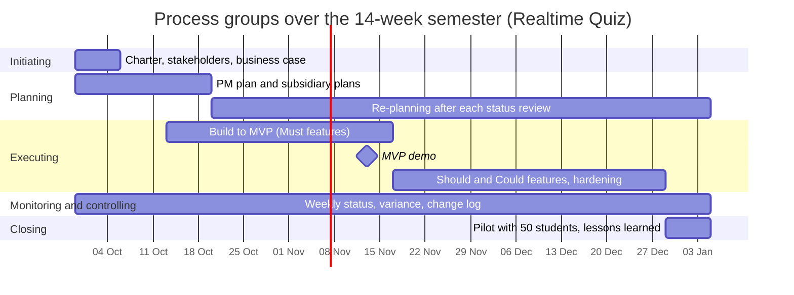

# Process Groups and Phase Gates: Realtime Quiz

## 1. Process groups across the 14-week semester

| Process group | Weeks active | Main activities | Outputs | Lab that produces them |
|---|---|---|---|---|
| Initiating | Week 1 | Defining project scope, identifying stakeholders, drafting charter and business case | Project charter, initial stakeholder list, business case | Lab 01 |
| Planning | Weeks 1–3 (initial burst) & Weeks 4–14 (ongoing re-planning) | Requirements breakdown, WBS definition, schedule creation, risk planning, sprint planning, and variance adjustments | Scope baseline, WBS, Gantt schedule, cost baseline, risk register, test plan | Labs 02, 03, 04, 05, 06, 07, 08, 09, 10, 11, 12 |
| Executing | Weeks 3–13 | Software development, UI implementation, WebSocket integration, unit/integration testing, sprint reviews | Working software increments, MVP release (week 7), final code repository, CI test suites | Labs 03, 04, 05, 07, 08 |
| Monitoring and controlling | Weeks 1–14 | Weekly status tracking, schedule and cost variance analysis, scope control, risk reviews, defect triage | Weekly status reports, burndown charts, change requests, change log | Labs 05, 06, 09 (tools), and every lab sprint |
| Closing | Week 14 | Deploying production release, conducting 50-student live pilot, gathering lessons learned, archival | Production deployment, pilot verification report, operational runbook, final project report | Lab 01, Lab 12 |

## 2. Process groups over the semester

## 3. Phase gates

To guarantee continued business justification and risk control throughout the semester, three formal phase gates require Sponsor approval before advancing:

1. **Gate 1: Charter Approval & Team Formation (End of Week 1)**  
   - *Decision:* Formal authorization to commit budget and begin technical execution.
   - *Evidence required:* Signed project charter, confirmed team roles, initial stakeholder list, and justified business case.

2. **Gate 2: MVP Mid-Project Review (End of Week 7)**  
   - *Decision:* Authorization to proceed with secondary features (Should/Could) and deployment hardening, or trigger contingency pivot to commercial SaaS (Option B).
   - *Evidence required:* Working live demonstration of 100% of Must features (quiz authoring, WebSocket real-time broadcast, live countdown timer, scoring engine, leaderboard) with 0 blocking defects.

3. **Gate 3: Pilot Readiness & Operational Handover (End of Week 13)**  
   - *Decision:* Final go/no-go authorization to run the live pilot session with 50 students in week 14.
   - *Evidence required:* Automated test suite green with >= 80% line coverage, successful load test sustaining 100 simulated concurrent students without errors, institutional data protection sign-off, and operational deployment runbook delivered to IT operations.
